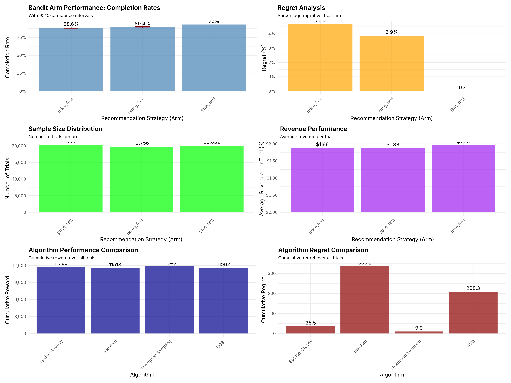

# A/B/C Test and Multi-Armed Bandits for a Ride-Hailing App

**Which way of ranking ride options should a ride-hailing app use by default? And would an adaptive bandit have found the best one at a lower cost than a fixed A/B split?**

The analysis covers about 60,000 app sessions in which users were randomly shown one of three recommendation strategies (`price_first`, `rating_first`, `time_first`). It is a three-step R pipeline: data cleaning, exploratory analysis with A/B testing, and a multi-armed bandit analysis.

> University group project (autumn 2025). This repository contains **my part**: the three R scripts in `R/`. Teammates' work, such as additional statistical tests and the combined final report, is not included.
> The original case data cannot be shared. `scripts/make_synthetic_data.R` generates data with the same 23 columns, value ranges and data-quality problems, and it plants known differences between the strategies. All numbers and charts below come from that synthetic data.



## Problem

The app logs each session: the strategy shown, the price and wait-time estimates, and whether a ride was requested and completed. The product questions are:

1. Do the strategies differ in **request rate** and in **completion rate given a request**?
2. Which strategy should become the default, and how sure can we be about it?
3. A fixed three-way split keeps sending users to weaker arms. How much of that *regret* would a bandit policy (ε-greedy, UCB1, Thompson Sampling) have avoided?

## Approach

| Step | Script | What it does |
|---|---|---|
| 1. Cleaning | `R/01_data_cleaning.R` | Schema validation (`checkmate`), duplicate-ID check, parsing of three mixed timestamp formats, standardised categories (region codes, a mistyped age group), range rules for every numeric field (outliers capped or set to NA), removal of rows missing key fields, feature engineering (peak hour, weekend, total fare with surge, wait-time error, conversion flags) |
| 2. Analysis and A/B test | `R/02_data_analysis.R` | Descriptive KPIs by strategy, region, hour and age group; chi-square test of request rate by strategy; ANOVA on fare and wait time; correlation matrix; seven charts and a text report |
| 3. Bandits | `R/03_multi_armed_bandit_analysis.R` | Completion rate per arm with 95% CIs; two-proportion z-tests against the best arm; chi-square test on completion; ANOVA with Tukey HSD on fare, wait time and rating; power analysis (`pwr`). It then simulates ε-greedy (ε = 0.1), UCB1, Thompson Sampling (Beta–Bernoulli) and a random baseline in an environment calibrated to each arm's observed completion rate, comparing cumulative reward and regret |

## Results (synthetic data)

**Completion rate given a request.** The pipeline recovers the planted effects.

| Strategy | Planted | Estimated (95% CI) | Requests |
|---|---|---|---|
| price_first | 88.0% | 88.6% [87.7, 89.5] | 4,522 |
| rating_first | 90.0% | 89.4% [88.4, 90.3] | 4,056 |
| **time_first** | **93.0%** | **93.0% [92.2, 93.7]** | 4,155 |

- The completion rates differ significantly between strategies (chi-square, p < 10⁻⁶), and so do the request rates (p = 3.9 × 10⁻⁶).
- `time_first` beats both other arms in the two-proportion z-tests (p = 2.8 × 10⁻¹² against price_first and 8.8 × 10⁻⁹ against rating_first). The recommendation is therefore to make `time_first` the default.
- **Bandit simulation** over the 12,733 requested rides, measured as cumulative regret against always picking the best arm:

  | Policy | Cumulative regret |
  |---|---|
  | Thompson Sampling | **9.9** |
  | ε-greedy | 35.5 |
  | UCB1 | 208.3 |
  | Random (fixed split) | 335.2 |

  Thompson Sampling loses about 3% of the completions that a fixed equal split gives up.

Full outputs are in `results/reports/` (both reports), `results/plots/` (15 charts) and `results/logs/` (run logs). Seeds are fixed, so the numbers reproduce.

## Changes made for this public version

These were made with Claude Code while preparing the repo. The original scripts are otherwise unchanged.

- **Data and paths:**
  - Course data replaced by the synthetic generator.
  - Absolute local paths and the case's company name removed.
  - Outputs written to `data/` and `results/`.
- **Fix: bandit rewards.** The simulations used the *logged* reward of each session, whatever arm the policy chose, so every policy earned the same total reward. Rewards are now drawn for the **chosen** arm from its observed completion rate.
- **Fix: arm indexing.** Arms were indexed by factor codes instead of names.
- **Fix: report recommendations.** The bandit report's algorithm and sample-size statements were fixed text. They are now computed from the results.
- **Fix: correlation matrix.** Constant columns are dropped before it, because they broke the `hclust` ordering.
- **Housekeeping:** an unused package (`janitor`) was removed, and `set.seed()` was added for reproducibility.

## Tech stack

R 4.3, using the tidyverse (dplyr, readr, lubridate, stringr, ggplot2), patchwork, corrplot, broom, pwr, and cli/glue/fs/checkmate. Package versions are recorded in `renv.lock`.

## How to run

```bash
Rscript -e 'install.packages("renv"); renv::restore()'   # or install the packages listed in renv.lock
Rscript scripts/make_synthetic_data.R      # writes data/raw/sessions_raw.csv (60,000 sessions)
Rscript R/01_data_cleaning.R               # -> data/processed/sessions_clean.csv
Rscript R/02_data_analysis.R               # -> results/plots/01-08, results/reports/analysis_report.txt
Rscript R/03_multi_armed_bandit_analysis.R # -> results/plots/09-15, results/reports/multi_armed_bandit_report.txt
```

Run the commands from the repository root. The whole pipeline takes well under a minute.

## Layout

```
R/          the three analysis scripts (my part of the project)
scripts/    synthetic data generator
results/    reports, plots and run logs from the synthetic run
data/       generated data (not in git)
```

## License

MIT (see `LICENSE`).
